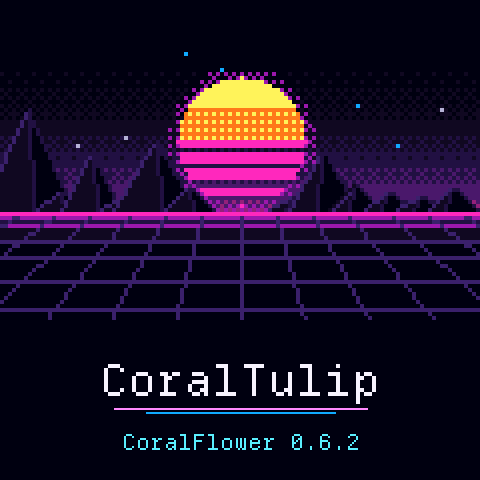
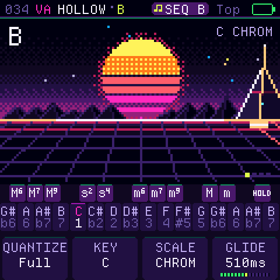
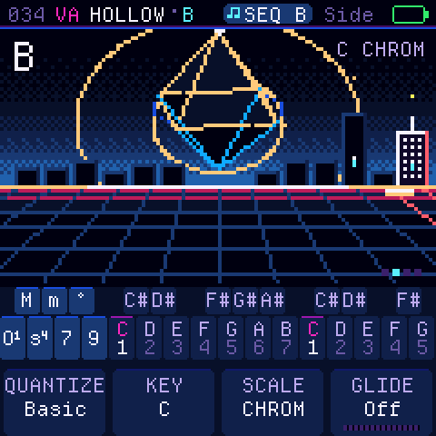
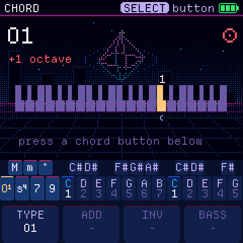
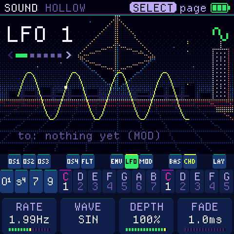
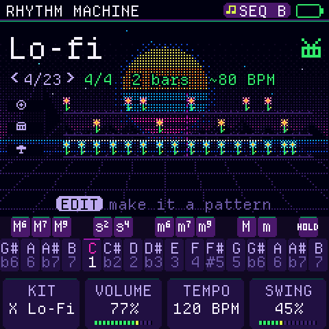
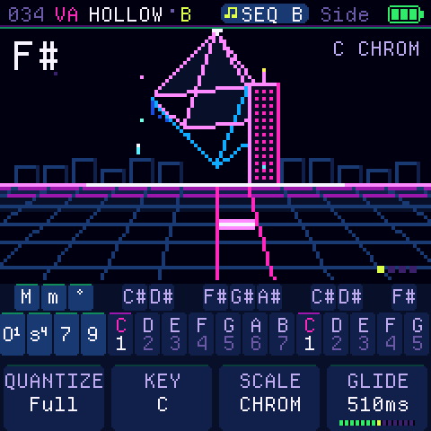

# CoralTulip

**Your M-VAVE FM-1, made for chords.** CoralTulip is custom chord-synth firmware for the M-VAVE FM-1, forked from [CoralFlower](https://github.com/FicusFicusov/CoralFlower). Press a chord key, and every note you play becomes a whole chord, with a bass underneath. While you play, a live 80s Synthwave visualizer reacts to your chords, notes, and arpeggiator.

CoralTulip is inspired by the Telepathic Instruments Orchid. Its controls are redesigned for the FM-1's keys and buttons, because every instrument is played differently.

<p align="center"></p>

<p align="center">
  <a href="https://mrtakfly.github.io/CoralTulip/play/"><b>Play it in your browser</b></a> ·
  <a href="https://mrtakfly.github.io/CoralTulip/"><b>Install it on your FM-1</b></a> ·
  <a href="https://github.com/MrTakfly/CoralTulip/releases"><b>Releases</b></a> ·
  <a href="CHANGELOG.md"><b>Changelog (0.6.2)</b></a>
</p>

Not sure yet? The [browser emulator](https://mrtakfly.github.io/CoralTulip/play/) runs the real firmware compiled to WebAssembly with sound. Try it with your mouse or computer keyboard before you install anything.

## What it does

- **Notes or chords.** The lower keys play the notes of a scale you choose. Press an upper key, and each note
  becomes a chord: major, minor, sus2 or sus4, plus major and minor 6, 7 and add9. Press two upper keys together to
  combine them. The chord stays on until you choose another one. The key marked Off turns chords off, and the keys
  play single notes, several at once. Choose from 27 scales, chromatic included, starting on any note. Chord glide (off by default) slides
  each note into the next chord.
- **Assignable Octave Modifier Chord Keys (`O1`, `o1`, `o2`, `O2`).** In the `SEL` chord button editor, `TYPE` (Knob 1) lets you assign `+1` (`O1`), `-1` (`o1`), `-2` (`o2`), or `+2` (`O2`) octave modifiers to any chord button. Hold an octave modifier together with a chord button (or over a latched chord in Lock mode) to transpose the chord and bass by ±1 or ±2 octaves, or hold it alone to transpose single notes.
- **Two layouts, each with a Lock mode.** In the Top layout, the upper row picks the chord type and the lower row the
  root. In the Side layout, a few keys on the left pick the type and the rest play roots. Lock mode keeps the chord
  type you tapped, so you don't have to hold its key. A new FM-1 starts in Top with Lock; without Lock, a chord
  plays only while you hold its key.
- **A bass part under your chords** (you can turn it off), with its own sound and range, plus an octaver that doubles each bass note.
- **An arpeggiator** with nine patterns, including a strum like the one on the Orchid chord synth. It locks to the
  metronome or to an external MIDI clock.
- **A rhythm machine & sequencer** with 23 ready-made drum rhythms, eight patterns of chords, bass, drums and layer, and a song made of them.
  REC on the main screen records what you play into a new pattern, after a one-bar count-in.
- **Six effects** in an order you choose: filter, drive, chorus, phaser, delay and reverb.
- **About 60 sounds** from two synth engines, virtual analogue and FM: pads, keys, strings and basses. Many pads
  change slowly on their own. Chords and basses have separate lists. Every sound has an editor, and you can save your
  own.
- **A plant that grows from your music.** In the Top key layout a flower grows; in the Side layout, a coral.
  Each note of the chord adds a part: a bloom, a bud, a cluster of berries. The plant's structure follows
  [PlantStudio](https://github.com/pdfernhout/PlantStudio), a program that models real plants.
- **MIDI over USB.** The chords, the bass and the sequencer's Layer and Drums go out on four channels you set. The
  FM-1 follows an external MIDI clock or sends its own.
- **Standalone USB-MIDI Backup & Restore Studio (`flower_backup_app.py`).** A desktop GUI and CLI librarian for Windows, WSL, macOS, and Linux that backs up, inspects, and restores all 26 flash objects over USB-MIDI without a browser, and comes bundled with the **MGMT - Kids** preset backup (`backups/20261030-194458_MGMT---Kids.json`).

<table>
  <tr>
    <td></td>
    <td></td>
    <td></td>
  </tr>
  <tr>
    <td></td>
    <td></td>
    <td></td>
  </tr>
</table>

## Backup & Restore Studio (`flower_backup_app.py`)

Launch the standalone desktop GUI (or double-click `CoralFlower_Backup.bat` on Windows):

```bash
python flower_backup_app.py
```

Or use the command-line interface (works natively on Windows, WSL, macOS, and Linux):

```bash
python flower_backup_app.py --info
python flower_backup_app.py --backup backups/my_backup.json
python flower_backup_app.py --restore backups/20261030-194458_MGMT---Kids.json --yes
python flower_backup_app.py --inspect backups/20261030-194458_MGMT---Kids.json
```

## Install

### Option 1: Browser Installer (GitHub Pages)

1. Open <https://mrtakfly.github.io/CoralTulip/> in **Chrome or Edge** on a computer. Only these browsers can talk
   to the FM-1 over USB.
2. Connect the FM-1 straight to the computer. Don't use a USB hub, and use a cable that carries data, not a
   charge-only one.
3. Press **Install on your FM-1**. Keep the page open and the cable plugged in for about a minute. The FM-1 restarts as
   CoralTulip.

### Option 2: Command-Line Installer (Windows, WSL, macOS, Linux)

```bash
python tools/fm1_install.py --yes build/release-0.6.2/coraltulip-0.6.2.fwsc
```

If the FM-1 runs CoralTulip, CoralFlower, ChoralRoot or Felucca, the installer automatically saves your sounds, patterns, and settings to a backup file first. The official firmware's sounds can't be backed up. To return to the stock firmware, download FM-1 V15 from [m-vave.com](https://www.m-vave.com) and install it from the same page or with `tools/fm1_install.py`. Installing firmware is at your own risk.

## Build it yourself

- **From a fresh clone.** Nothing generated is in git: every build first writes the fonts, icons, tables and samples
  into `build/gen/`, with Python 3, Pillow and fontTools. `python3 tools/build.py --gen-only` does that step alone, for
  any other way of building the firmware. On GitHub, the check workflow (`.github/workflows/check.yml`) builds a fresh
  clone on every push.
- **The emulator and the site.** Install the [Emscripten SDK](https://emscripten.org), then run
  `sh tools/emu/web/build_web.sh` and `sh tools/make_site.sh build/site`. The site lands in `build/site/`, with the
  emulator in `build/site/play/`. On GitHub, `.github/workflows/pages.yml` builds and publishes the site to GitHub Pages.
- **The headless runner.** `sh tools/emu/cf_headless.sh SCRIPT` plays a script of key presses, takes screenshots and
  records audio. The tests use it.
- **The firmware package.** `./build.sh --release 0.6.2` needs the toolchain from JieLi, the maker of the FM-1's chip.
  The toolchain runs on Linux x86-64 (including WSL on Windows), and `tools/get_toolchain.sh` fetches it. On GitHub, the release workflow
  (`.github/workflows/release.yml`) builds the package automatically when a `v*` tag is pushed.

## Credits and licence

CoralTulip is a fork of **[CoralFlower](https://github.com/FicusFicusov/CoralFlower)** by [FicusFicusov](https://github.com/FicusFicusov), which is a fork of **[ChoralRoot FM-1](https://github.com/Quixotic7/ChoralRootFM1)** by Quixotic7, which is itself
a fork of **[Felucca](https://github.com/hugelton/Felucca)** by Leo Kuroshita (Hügelton Instruments). The FM engine comes
from **[Melodee](https://github.com/keremimo/melodee)** by Kerem Kilic, and the screens use
**[Departure Mono](https://departuremono.com)**, a font by Helena Zhang. Huge thanks to all of the original authors and contributors.

CoralTulip is free software under the GPL-3.0. `LICENSE` and `LICENSING.md` have the details.

M-VAVE and FM-1 are trademarks of their respective owners. Orchid is a product of Telepathic Instruments. CoralTulip
is not affiliated with M-VAVE, Cuvave or Telepathic Instruments.

## Issues and contributions

Found a bug or have a feature request for CoralTulip? Open an issue or pull request on [GitHub](https://github.com/MrTakfly/CoralTulip/issues).
